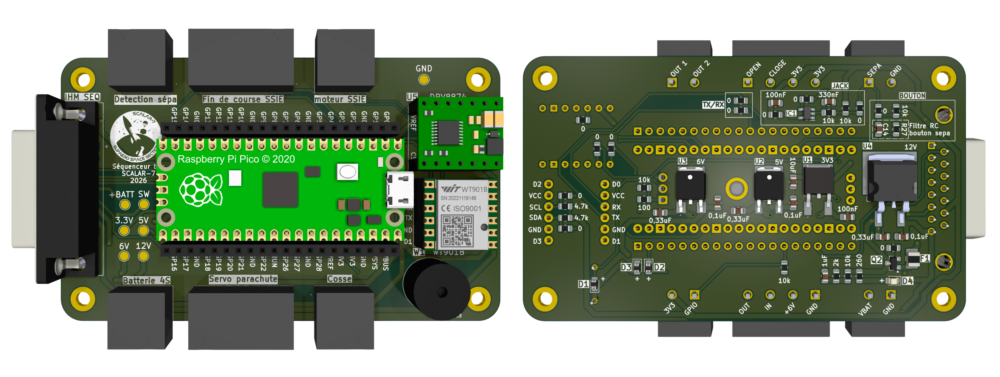
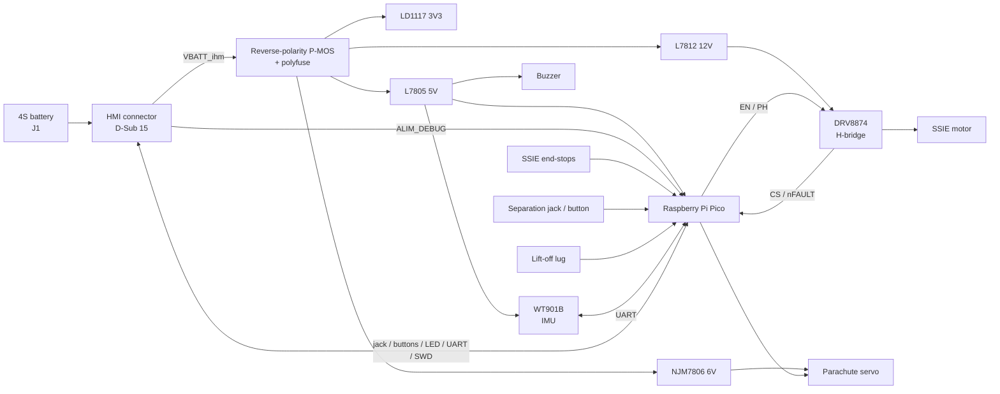

<p align="center">
  
</p>

# SCALAR-7 : Sequenceur Bas

<p align="center">
  
  
  
  
</p>

Sequencer board of the **lower stage** of **SCALAR-7**, a two-stage rocket launched at **C'Space 2026**.
It handles the lower stage's flight events: lift-off detection, stage separation through the **SSIE** motor, separation detection and parachute deployment.

---
## Table of contents

- [Board features](#board-features)
- [Architecture](#architecture)
  - [Power supply](#power-supply)
  - [Microcontroller](#microcontroller)
  - [Stage separation](#stage-separation)
  - [Parachute](#parachute)
  - [Sensors](#sensors)
  - [HMI connection](#hmi-connection)
- [Main components](#main-components)
- [Repository structure](#repository-structure)

---

## Board features

| Function | Implementation |
|---|---|
| Processing / sequencing | Raspberry Pi **Pico** (RP2040) |
| Lift-off detection | Connector for the lift-off detection lug |
| Stage separation | **DRV8874** H-bridge driving the SSIE DC motor (12 V), with current sensing and fault output |
| SSIE position | Connector for two end-stop switches (open / closed) |
| Separation detection | Jack (with Schmitt trigger filtering) or push button, on a shared connector |
| Parachute | Servo connector (6 V) |
| Flight measurements | **WitMotion WT901B** inertial measurement unit (UART, I²C optional) |
| Power supply | 4S battery, protected input (reverse polarity, overcurrent), 3.3 V, 5 V, 6 V and 12 V regulators |
| HMI interface | D-Sub 15 connector: power switch, jack, status LED, manual commands, debug UART and SWD, rail status LEDs |
| Indicators | Buzzer, power LED |

---

## Architecture



### Power supply

The board is powered by a **4S** battery. The supply goes through the HMI before coming back to the board, so the sequencer is switched on from the outside. The input is protected against reverse polarity (P-MOSFET) and overcurrent (polyfuse), then four linear regulators generate the **3V3** (logic), **5V** (Pico, IMU, buzzer), **6V** (parachute servo) and **12V** (SSIE motor) rails.

### Microcontroller

A **Raspberry Pi Pico** runs the flight sequence: it reads the detection inputs and the IMU, then drives the SSIE motor and the parachute servo. It is mounted on two pin headers that also serve as test points. Its VSYS input is supplied either by the board's 5V rail or by the HMI debug supply through two diodes, so it can be programmed without the battery.

### Stage separation

- **SSIE motor**: a **DRV8874** H-bridge (PH/EN mode) drives the separation DC motor from the 12V rail. The Pico controls its direction and enable, and reads back the motor current (ADC) and the fault output.
- **SSIE position**: two end-stop switches mounted on the SSIE shaft tell the Pico when the mechanism is fully open or fully closed.
- **Separation detection**: the separation can be detected either by a jack, filtered by an RC network and a Schmitt trigger, or by a push button. Both share the same connector, so only one of them needs to be wired.

### Parachute

A servo connector, powered from the 6V rail, deploys the parachute.

### Sensors

- **Lift-off detection**: a connector for the lift-off detection lug, read by the Pico with a pull-down resistor.
- **Flight measurements**: **WT901B** inertial measurement unit, connected over UART. It provides accelerations, angular rates, attitude, pressure, altitude and temperature.

### HMI connection

The **D-Sub 15** connector links the board to the HMI. It carries the battery supply (out and back, for switching the board on), the jack, the status LED, the manual parachute and SSIE commands, the Pico's debug UART and SWD, and the four supply rails for the status LEDs on the HMI.

---

## Main components

| Ref. | Component | Function |
|---|---|---|
| — | Raspberry Pi Pico | Microcontroller |
| U5 | TI DRV8874 | H-bridge motor driver |
| IC1 | TI SN74LVC1G17DBVT | Schmitt trigger buffer (separation jack) |
| W1 | WitMotion WT901B | IMU with barometer |
| U1 | ST LD1117DT33TR | 3.3 V regulator |
| U2 | ST L7805CDT-TR | 5 V regulator |
| U3 | NJR NJM7806DL1A | 6 V regulator |
| U4 | ST L7812 | 12 V regulator |
| Q2 | onsemi FDN360P | Reverse-polarity protection |
| F1 | Littelfuse 1210L110/16WR | Polyfuse |
| Q1 | N-MOSFET | Buzzer driver |
| J2 | D-Sub 15 | HMI connection |
| J4 | 4-pin connector | Parachute servo |
| J7 | 2-pin connector | SSIE motor |
| J9 | 4-pin connector | SSIE end-stops |
| J12 | 2-pin connector | Separation detection |

---

## Repository structure

```
SCALAR-7_Sequenceur_Bas/
├── hardware/          # KiCad project
├── images/
├── schematic.pdf
└── README.md
```

---